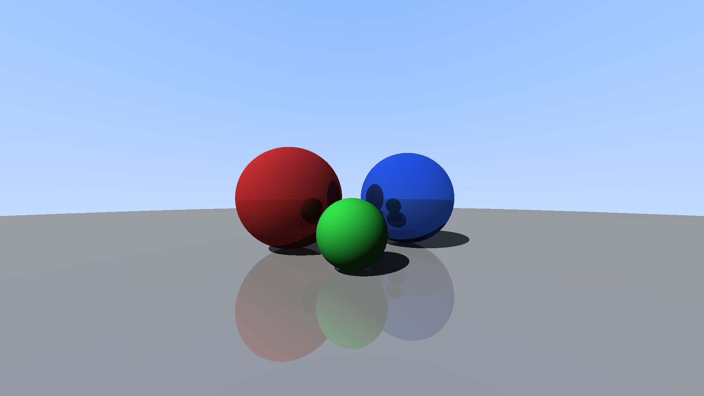
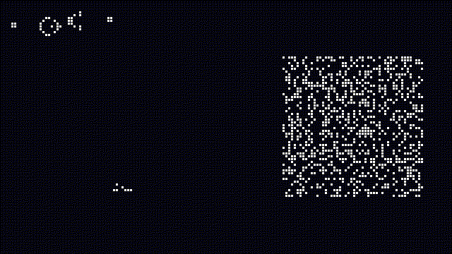

# ZLox

ZLox is an implementation of the **Lox** programming language written in
[Zig](https://ziglang.org/). It follows the bytecode virtual machine (`clox`)
from Robert Nystrom's book [*Crafting Interpreters*](https://craftinginterpreters.com/):
source code is scanned into tokens, compiled in a single pass to bytecode, and
executed on a stack-based VM with closures, classes, inheritance and a
mark-and-sweep garbage collector.

This is an **educational project**. I use it to learn how interpreters and
virtual machines work, so the code favors clarity over completeness. It is not
a production-grade VM. Performance does matter, but mostly as a way to learn
how the optimizations work.

## Code layout

| File | Responsibility |
| --- | --- |
| [`src/main.zig`](src/main.zig) | CLI entry point and REPL |
| [`src/engine.zig`](src/engine.zig) | Ties compilation and execution together; holds the integration tests |
| [`src/scanner.zig`](src/scanner.zig) | Turns source text into tokens |
| [`src/compiler.zig`](src/compiler.zig) | Single-pass Pratt parser that emits bytecode |
| [`src/chunk.zig`](src/chunk.zig) | Bytecode chunks, opcodes and the disassembler |
| [`src/vm.zig`](src/vm.zig) | The bytecode interpreter and native functions |
| [`src/value.zig`](src/value.zig), [`src/heap.zig`](src/heap.zig) | Runtime values, heap objects and the garbage collector |

## Additions to the language

Everything from the book is supported. On top of that, ZLox adds a few
features that make it possible to write bigger programs (like the ones shown
below).

### Arrays

Array literals use square brackets and can hold any mix of values. Arrays are
objects with native methods:

```lox
var a = [1, 2];
a.push(3);           // [1, 2, 3]
var last = a.pop();  // 3
a.set(0, "first");
print a.get(0);      // first
print a.len();       // 2
print ["a", 1, true, nil].join(", "); // a, 1, true, nil

var push = a.push;   // methods can be read as bound methods
push(4);
```

Reading or writing outside the array's bounds is a runtime error.

### `continue` statement

`continue` jumps to the next iteration of the enclosing `while` or `for` loop.
It is one of the challenges in the book, not part of the core language.

### Extra native functions

The book only ships `clock()`. ZLox has these natives:

| Function | Description |
| --- | --- |
| `clock()` | Current wall-clock time in milliseconds |
| `random()` | A pseudo-random number in `[0, 1)` (fixed seed, so runs are repeatable) |
| `sqrt(x)` | Square root |
| `floor(x)` | Round down to a whole number (Lox has no `%`, so this is also how you write modulo) |
| `str(x)` | Convert any value to a string |
| `readLine()` | Read one line from standard input |
| `writeFile(path, text)` | Write a string to a file, replacing its contents |
| `appendFile(path, text)` | Append a string to a file |

### Larger limits

The book's `clox` stops at 256 local variables and 256 constants per
function, because most operands are one byte. ZLox adds an `OP_EXTRA_ARG` prefix
instruction that widens the operand of the next instruction, so functions can
have more locals, upvalues and constants. See
[`docs/extra-arg-design.md`](docs/extra-arg-design.md) for how it works.

## Sample programs

The [`programs/`](programs/) directory has a few larger Lox programs that
show what the interpreter can do. They write their output as plain-text PPM
images using arrays, `str()`, `join()` and `writeFile()`.

### Mandelbrot set

[`programs/mandelbrot.lox`](programs/mandelbrot.lox) renders the Mandelbrot
set at 1920×1080 with smooth coloring. Lox has no `log` function, so the
program computes a base-2 logarithm by hand.


### Raytracer

[`programs/raytracer.lox`](programs/raytracer.lox) is a small raytracer
built from Lox classes (`Vec`, `Sphere`, ...). It supports diffuse shading,
hard shadows and mirror reflections.



### Game of Life

[`programs/game_of_life.lox`](programs/game_of_life.lox) runs Conway's Game
of Life on a random grid and writes every few generations as a frame. Cells are
colored by age and leave a fading trail when they die.



### Running them yourself

Use a release build, because these programs do a lot of work:

```sh
zig build -Doptimize=ReleaseFast
./zig-out/bin/zlox programs/mandelbrot.lox
./zig-out/bin/zlox programs/raytracer.lox
./zig-out/bin/zlox programs/game_of_life.lox
```

The images are written to `.zig-cache/` as `.ppm` files. To convert them to
PNG or GIF, use a tool such as [ffmpeg](https://ffmpeg.org/):

```sh
ffmpeg -i .zig-cache/zlox_mandelbrot_sample.ppm output/mandelbrot.png
ffmpeg -i .zig-cache/zlox_raytracer_sample.ppm output/raytracer.png
ffmpeg -framerate 15 -i .zig-cache/zlox_life_%03d.ppm output/game_of_life.gif
```

## Building, running and testing

### Requirements

- Zig **0.16** (the code uses the new `std.Io` APIs)
- Optional: [Nix](https://nixos.org/). Run `nix develop` to get a shell with
  Zig, ZLS, LLDB and `nixfmt`.

Run all commands from the repository root, because the tests find their
fixtures through relative paths.

### Build and run

```sh
zig build                              # builds zig-out/bin/zlox
zig build run                          # starts the REPL
zig build run -- samples/023_for.lox   # runs a Lox file
```

The CLI uses the exit codes from the book: `65` for a compile error and `70`
for a runtime error.

Debug output can be turned on per layer with build options:

```sh
zig build run -Ddebug-scanner=true -- samples/023_for.lox   # tokens
zig build run -Ddebug-compiler=true -- samples/023_for.lox  # disassembled bytecode
zig build run -Ddebug-vm=true -- samples/023_for.lox        # stack trace of each instruction
zig build run -Ddebug-gc=true -- samples/023_for.lox        # garbage collector activity
```

### Test

```sh
zig build test
zig fmt --check src build.zig build.zig.zon
```

Unit tests live next to the code they test. Language behavior is tested with
the numbered programs in [`samples/`](samples/), each paired with a test in
[`src/engine.zig`](src/engine.zig) that checks its output or expected error.

### Benchmarks

```sh
zig build bench            # runs every benchmark in bench/lox with a ReleaseFast build
zig build bench -- fib loop  # runs only benchmarks whose name contains "fib" or "loop"
```
